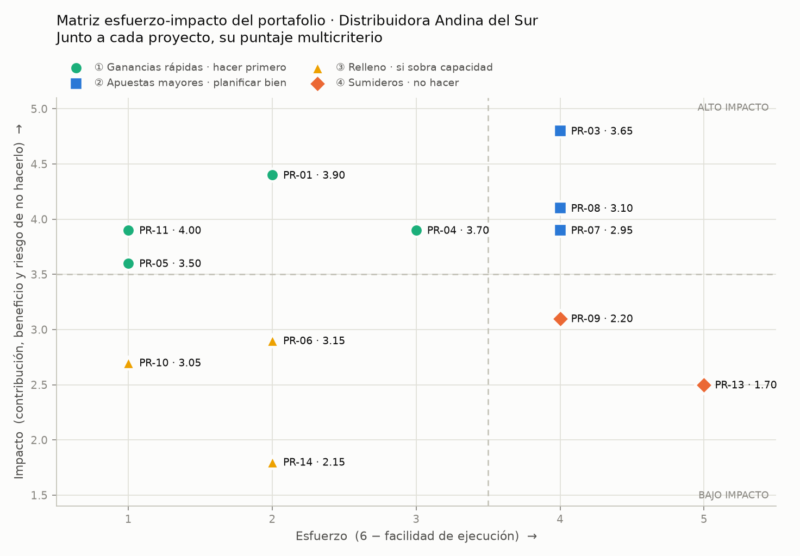
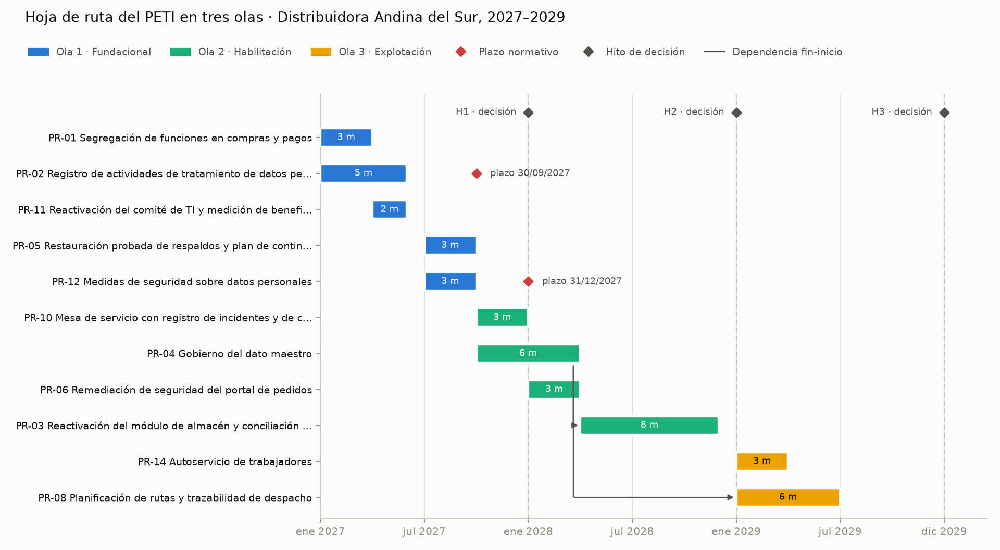
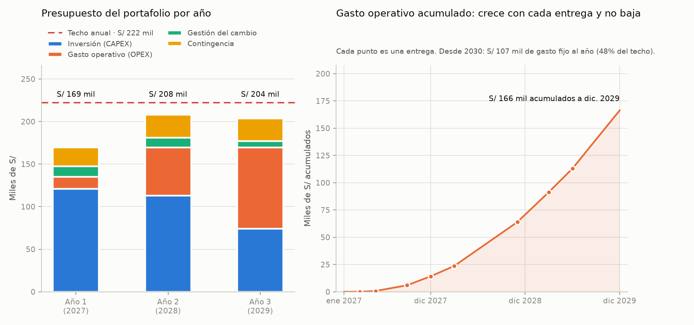

# PETI · Distribuidora Andina del Sur S.A.C. — Secciones 7.2 a 7.4

> Versión `v0.14` del PETI. Clasificación: **Confidencial** (contiene el presupuesto de la organización).
> Las cifras de costo son estimaciones de orden de magnitud del equipo, sin cotizaciones, y se
> presentan con su rango de incertidumbre. Los pesos y el techo presupuestal son la propuesta que
> el equipo lleva a la Entrevista 3 (ver `PR02_pesos.md`).

## 7.2 Priorización del portafolio

### 7.2.1 Proyectos no negociables y su plazo

De los 14 proyectos candidatos, dos no entran al modelo. Los impone una norma vigente y
supervisada por la ANPD, uno de los cuatro reguladores de la empresa. Una multa no se negocia
contra un beneficio, así que se ubican en la hoja de ruta por su fecha.

| Proyecto | Norma | Plazo límite del plan | Termina | Margen |
|---|---|---|---|---|
| **PR-02** Registro de actividades de tratamiento de datos personales | Ley 29733 y D. S. 016-2024-JUS | 30/09/2027 | Mayo de 2027 | 4 meses |
| **PR-12** Medidas de seguridad sobre datos personales | Ley 29733 art. 9 y D. S. 016-2024-JUS | 31/12/2027 | Septiembre de 2027 | 3 meses |

La norma ya está vigente y no concede un plazo nuevo. La fecha límite es la que el plan se
compromete a no pasar ante la gerencia. Fuente: `PR01_portafolio_marcado.csv`.

### 7.2.2 Modelo multicriterio · criterios, pesos y su justificación acordada

Puntaje = Σ (calificación del criterio × peso del criterio), en escala de 1 a 5. Los pesos se
fijaron antes de calcular y viven en un solo archivo, `PR02_pesos.md`, que el programa lee.

| Criterio | Peso | Por qué ese peso en esta organización |
|---|---|---|
| Contribución a los objetivos | 0.25 | El objetivo declarado de TI es restablecer el control interno y conciliar el inventario |
| Beneficio económico | 0.10 | Las tres inversiones de 2025 declararon un beneficio y en ninguna se midió: es el dato menos confiable |
| Urgencia | 0.15 | Incidente abierto de fraccionamiento de compras, portal sin soporte y dos contratos vencidos |
| Habilitación | 0.15 | Cuatro proyectos de valor dependen del dato maestro |
| Riesgo de no hacerlo | 0.10 | Tres riesgos conocidos sin tratar y respaldos que nunca se han restaurado |
| Facilidad de ejecución | 0.10 | Equipo de TI de 4 personas; la partida de proyectos se ejecutó al 66 % en 2025 |
| Aceptación organizacional | 0.05 | Hoy los cambios se aplican sin registro ni aprobación |
| **Impacto social y ambiental** | **0.10** | Criterio obligatorio. Distribución por carretera y clientes que son bodegas pequeñas |
| **Suma** | **1.00** | |

### 7.2.3 Resultados de la priorización

| Puesto | Proyecto | Puntaje | Cuadrante |
|---|---|---|---|
| 1 | PR-11 Reactivación del comité de TI y medición de beneficios | 4.00 | ① Ganancia rápida |
| 2 | PR-01 Segregación de funciones en compras y pagos | 3.90 | ① Ganancia rápida |
| 3 | PR-04 Gobierno del dato maestro | 3.70 | ① Ganancia rápida |
| 4 | PR-03 Reactivación del módulo de almacén y conciliación del inventario | 3.65 | ② Apuesta mayor |
| 5 | PR-05 Restauración probada de respaldos y plan de continuidad | 3.50 | ① Ganancia rápida |
| 6 | PR-06 Remediación de seguridad del portal de pedidos | 3.15 | ③ Relleno |
| 7 | PR-08 Planificación de rutas y trazabilidad de despacho | 3.10 | ② Apuesta mayor |
| 8 | PR-10 Mesa de servicio con registro de incidentes y de cambios | 3.05 | ③ Relleno |
| 9 | PR-07 Rediseño móvil del canal de pedidos de la bodega | 2.95 | ② Apuesta mayor |
| 10 | PR-09 Analítica de demanda y tablero comercial | 2.20 | ④ Sumidero |
| 11 | PR-14 Autoservicio de trabajadores | 2.15 | ③ Relleno |
| 12 | PR-13 Cambio del ERP por una versión en nube | 1.70 | ④ Sumidero |

Fuente: `PR03_priorizado.csv`, con las ocho calificaciones de cada proyecto.

### 7.2.4 Matriz esfuerzo-impacto

Los cuatro cuadrantes quedaron poblados: cuatro ganancias rápidas, tres apuestas mayores, tres
proyectos de relleno y dos sumideros. Impacto = 0.5 × contribución + 0.3 × beneficio + 0.2 ×
riesgo de no hacerlo; esfuerzo = 6 − facilidad; ambos umbrales en 3.5.

### 7.2.5 **Proyectos que NO se ejecutarán** y el riesgo que la organización asume

| Proyecto | Por qué no | Riesgo que la organización asume | Acepta el riesgo | Se revisa |
|---|---|---|---|---|
| **PR-13** Cambio del ERP | Cuadrante ④, puntaje 1.70. El ERP tiene soporte vigente; el problema del almacén es de uso, no del producto | Seguir sobre un ERP de 2015 en servidor propio | Gerente General | H3, diciembre de 2029, o antes si el proveedor anuncia fin de soporte |
| **PR-09** Analítica de demanda | Cuadrante ④, puntaje 2.20. Un pronóstico sobre un inventario que difiere 4.7 % no se sostiene | Reposición por experiencia; se mantienen el sobrestock y los quiebres | Gerente Comercial | H3, diciembre de 2029 |
| **PR-07** Canal de pedidos móvil | Cuadrante ②, puntaje 2.95. **No cabe en el presupuesto**: incluirlo en 2029 excede el techo en S/ 103 329 | Tres años sin crecer en el canal digital; un competidor puede captar bodegas | Gerente General con el Gerente Comercial | H2, diciembre de 2028 |

PR-07 es el proyecto que la gerencia comercial más pide y no es un sumidero. Queda fuera por el
gasto operativo que el plan acumula, no por su valor. Fuente: `PR07_no_se_hara.csv`.

## 7.3 Hoja de ruta

### 7.3.1 Restricciones · dependencias, plazos, capacidad y absorción del cambio

| Restricción | Regla aplicada | Efecto en la secuencia |
|---|---|---|
| Dependencias | PR-03 y PR-08 dependen de PR-04; PR-07 y PR-09, de PR-04 y PR-03 | PR-03 puntúa 3.65 y empieza en abril de 2028, cuando el dato maestro está entregado |
| Plazos normativos | Los no negociables terminan un trimestre antes de su fecha | PR-02 arranca en enero de 2027; PR-12, en julio |
| Capacidad simultánea | Máximo 2 proyectos por trimestre | PR-11 puntúa primero y arranca en abril, cuando PR-01 libera capacidad |
| Absorción del cambio | Nunca dos proyectos sobre la misma área; uno transversal solo coincide con uno interno de Sistemas | PR-12, que toca a todos los usuarios, coincide solo con PR-05 |

### 7.3.2 Olas de implantación y su fundamento

| Ola | Periodo | Proyectos | Fundamento |
|---|---|---|---|
| **1 · Fundacional** | Enero a septiembre de 2027 | PR-02, PR-01, PR-11, PR-05, PR-12 | Cierra la exposición legal y el incidente de compras, pone a funcionar el comité que decidirá el resto y prueba que el respaldo se puede restaurar |
| **2 · Habilitación** | Octubre de 2027 a noviembre de 2028 | PR-04, PR-10, PR-06, PR-03 | El dato maestro desbloquea el almacén; la mesa de servicio crea la línea base de incidentes; se trata el riesgo del portal |
| **3 · Explotación** | Enero a junio de 2029 | PR-08, PR-14 | El ruteo solo sirve con un maestro de clientes único. PR-14 es relleno: entra porque sobra capacidad y cabe en el techo |

### 7.3.3 Cronograma plurianual con hitos de decisión

Detalle por proyecto en `PR05_hoja_ruta.csv`; cronograma para GanttProject en `PR05_hoja_ruta.gan`.
En cada hito (diciembre de 2027, 2028 y 2029) el comité de TI decide continuar, ajustar o
detener, con el gasto real de la ola cerrada a la vista.

### 7.3.4 Verificación · dependencias respetadas y capacidad no excedida

`PR04_hoja_ruta.py` verifica la hoja de ruta registrada: 0 dependencias rotas, 0 duraciones
inconsistentes, 0 no negociables sin margen, 0 trimestres sobre la capacidad y 0 choques de área
usuaria. Salida completa en `evidencias/S14/salidas/PR04_hoja_ruta.txt`.

## 7.4 Presupuesto

### 7.4.1 Estructura · CAPEX, OPEX, gestión del cambio y contingencia

| Línea | Regla | Fundamento |
|---|---|---|
| Inversión (CAPEX) | Costo único de `PF02_tco.csv`, repartido en los meses de ejecución | Inversión inicial, capacitación, migración e integración |
| Gasto operativo (OPEX) | Costo anual de `PF02_tco.csv`, desde el mes siguiente a la entrega | Licencias, infraestructura, soporte y personal |
| Gestión del cambio | 10 % de la inversión del año | Rango de referencia 8–12 % |
| Contingencia | 15 % del subtotal del año | Las tres inversiones de 2025 se desviaron +30.4 %, +20.5 % y +16.5 % |
| Techo anual | S/ 222 000 | S/ 742 000 de presupuesto de TI menos S/ 520 000 comprometidos en operación |

### 7.4.2 Presupuesto por año

| Año | CAPEX | OPEX | Gestión del cambio | Contingencia | **Total** | Holgura frente al techo | Rango de incertidumbre |
|---|---|---|---|---|---|---|---|
| 1 (2027) | 121 000 | 14 183 | 12 100 | 22 092 | **169 376** | 52 624 | 135 031 a 203 721 |
| 2 (2028) | 113 000 | 56 590 | 11 300 | 27 134 | **208 024** | 13 976 | 160 649 a 255 398 |
| 3 (2029) | 74 000 | 95 570 | 7 400 | 26 546 | **203 516** | 18 484 | 173 156 a 233 875 |
| **Total** | **308 000** | **166 343** | **30 800** | **75 772** | **580 916** | | |

Cifras en soles. Fuente: `PR06_presupuesto.csv`. En 2027 sobra presupuesto y no capacidad: los
cuatro trimestres ya tienen dos proyectos. En 2028 y 2029 ocurre lo contrario.

### 7.4.3 **Curva de gasto operativo acumulado** y su interpretación

| Año | OPEX del año | Proporción del techo | OPEX acumulado |
|---|---|---|---|
| 2027 | 14 183 | 6.4 % | 14 183 |
| 2028 | 56 590 | 25.5 % | 70 773 |
| 2029 | 95 570 | 43.0 % | 166 343 |
| Desde 2030 | 106 720 | 48.1 % | — |

El gasto operativo del año 3 es 6.7 veces el del año 1. Desde 2030, sin aprobar un solo proyecto
nuevo, el plan deja S/ 106 720 de gasto fijo al año: casi la mitad del techo. Ese es el compromiso
que la gerencia asume al aprobar el plan, y es la razón por la que PR-07 no cabe.

### 7.4.4 Supuestos y rangos de incertidumbre

1. **Techo de S/ 222 000.** `presupuesto_ti.csv` registra S/ 682 640 planificados en operación y
   S/ 59 360 en proyectos nuevos, de los que se ejecutaron S/ 39 242. El techo exige que la
   gerencia reasigne o amplíe presupuesto. Se confirma en la Entrevista 3.
2. **Extremo alto del rango.** Con la incertidumbre de cada proyecto (±15 % a ±50 %), 2028 puede
   llegar a S/ 255 398 y 2029 a S/ 233 875, por encima del techo en S/ 33 398 y S/ 11 875. El
   plan no lo oculta: en H1 y H2 el comité compara el gasto real con el estimado y, si se
   confirma el extremo alto, retira PR-14 y desplaza PR-08.
3. **Costos sin cotización.** Las cifras de `PF02_tco.csv` son estimaciones del equipo.
4. **Personal.** El costo anual incluye el personal adicional de soporte de cada proyecto, no las
   horas del equipo actual de 4 personas, que ya están en la partida de operación.
